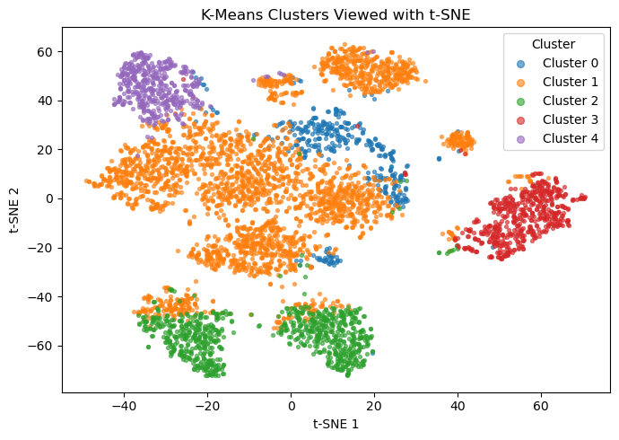
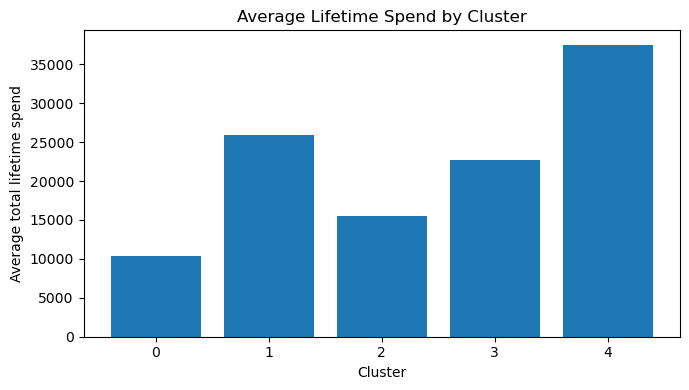
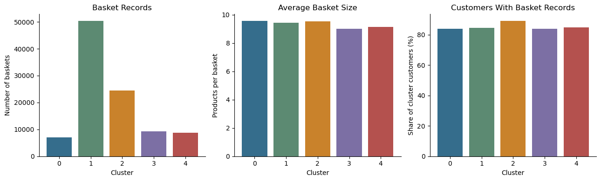

# Customer Segmentation Using Unsupervised Learning

*Machine Learning II — University Group Project, Nova IMS*

---

## Overview

This repository contains an academic customer segmentation project developed as part of the Machine Learning II course at Nova IMS. The objective was to apply unsupervised learning techniques to retail customer data to discover meaningful customer groups, understand their purchasing habits, and explore how data-driven segments can inform targeted marketing proposals.

The complete analysis pipeline—from exploratory data analysis and feature engineering to model comparison, post-clustering basket analysis, and association rules—is organized across twelve numbered Jupyter notebooks and documented in [`report.md`](report.md) and [`DECISIONS.md`](DECISIONS.md).

---

## Objectives

- Analyze customer demographic and transactional basket data to uncover behavioural patterns.
- Engineer a compact, robust feature set that avoids data leakage and imputation bias.
- Systematically compare clustering algorithms (K-Means, GMM, Agglomerative, DBSCAN) on internal metrics and practical interpretability.
- Profile identified customer groups using lifetime spending shares and post-clustering transaction records.
- Formulate evidence-based promotional strategies while clearly identifying the limits of observational retail data.

---

## Data and Preprocessing

The analysis relies on two raw datasets that were kept unmodified throughout the project:

- **`customer_info.csv`** (33,038 customers): Customer-level demographics (age, education prefix, household children), lifetime spend by category (groceries, electronics, hygiene, meat, etc.), store visit counts, promotion responsiveness, complaint counts, and tenure.
- **`customer_basket.csv`** (transaction records covering 28,127 customers): Basket contents across 164 distinct products, with basket sizes ranging from 1 to 18 items.

### Key Preprocessing Decisions

1. **Basket data excluded from clustering:** Approximately 15% of customers (4,911) have no recorded basket transactions. Including basket-derived metrics in the clustering matrix would require either imputing unobserved records (introducing artificial assumptions) or dropping customers (violating the requirement to segment the full customer base). Basket data was therefore reserved for post-clustering analysis.
2. **Compact feature matrix:** 20 numeric features were selected, focusing on spending category proportions (`share_*`), overall spend, tenure, age, household dependents, and promotion responsiveness. Categorical dummy columns (gender, degree prefixes) were removed after sensitivity checks confirmed they diluted cluster separation.
3. **RobustScaler:** Retail expenditure is right-skewed with heavy tails. RobustScaler uses median and interquartile ranges, outperforming StandardScaler and MinMaxScaler in silhouette and Davies-Bouldin evaluations on this dataset.

---

## Methodology and Model Selection

Four clustering approaches were evaluated on the scaled 20-feature input:

- **K-Means (k = 2 to 10):** Evaluated with inertia, silhouette scores, Calinski-Harabasz, and Davies-Bouldin metrics with `n_init=50`.
- **Gaussian Mixture Models (diagonal covariance, k = 4, 5, 6):** Produced lower silhouette scores (0.10–0.12) and less balanced cluster distributions.
- **Agglomerative Clustering (Ward linkage, sample N = 5,000):** Showed comparable or inferior separation to K-Means without additional interpretability benefits.
- **DBSCAN (parameter grid on sample N = 5,000):** Grouped over 95% of observations into a single dense cluster or classified them as noise, demonstrating that retail customer behaviour in this feature space does not form density-isolated pockets.

### The Metric vs. Interpretability Trade-Off

| Model / k | Silhouette Score | Calinski-Harabasz | Davies-Bouldin | Min / Max Cluster Share |
|---|---:|---:|---:|---:|
| K-Means (k=2) | 0.364 | 8,195 | 1.309 | 12.5% / 87.5% |
| K-Means (k=3) | 0.274 | 7,124 | 1.299 | 9.4% / 78.4% |
| K-Means (k=4) | 0.239 | 7,018 | 1.584 | 9.0% / 61.1% |
| **K-Means (k=5, selected)** | **0.221** | **6,347** | **1.539** | **7.9% / 55.6%** |
| K-Means (k=6) | 0.152 | 5,767 | 1.854 | 5.3% / 30.0% |

While k=2 yields the highest mathematical separation, a two-group solution is commercially uninformative. **K-Means at k=5** was selected because it preserves reasonable separation metrics while capturing five distinct, actionable customer profiles. Seed stability tests across five random initializations confirmed high reproducibility (Adjusted Rand Index > 0.999).

---

## Customer Segments

| Cluster | Persona | Customers | Share | Defining Characteristics |
|:---:|---|---:|---:|---|
| 0 | Promo-Sensitive Older Tech Snackers | 2,619 | 7.9% | Lowest lifetime spend (£10.3k), highest promotion usage (45.1%), elevated electronics and snack purchases. |
| 1 | Mainstream Grocery Families | 18,385 | 55.6% | Core retail base; 75.9% of spend allocated to groceries with high fresh-produce frequency. |
| 2 | Vegetarian-Leaning Family Households | 5,538 | 16.8% | Highest vegetable share (12.7%), lowest meat spend (0.8%), high basket coverage (89.1%), low promotion sensitivity (13.3%). |
| 3 | Demanding Personal-Care & Tech Shoppers | 3,552 | 10.8% | Highest electronics share (37.5%), lowest loyalty card adoption (49.2%), highest complaint rate (1.08/customer). |
| 4 | High-Value Large Loyal Families | 2,944 | 8.9% | Highest average spend (£37.5k), largest household size (mean 6.4 dependents), longest tenure, low promotion reliance. |

---

## Visualisations

The figures below illustrate the cluster separation and behavioural differences across segments, exported directly from the analysis notebooks:

### Cluster Separation in 2D Space

*Figure 1: 2D t-SNE projection of the five customer segments (from `notebooks/05_kmeans_baseline.ipynb`). Rather than discrete islands, customer groups reflect continuous behavioural transitions with distinct core densities.*

### Financial Differentiation Between Segments

*Figure 2: Mean lifetime spend by cluster (from `notebooks/05_kmeans_baseline.ipynb`), highlighting the substantial variance between discount-sensitive shoppers (Cluster 0) and high-value family accounts (Cluster 4).*

### Transaction and Basket Profiling

*Figure 3: Post-clustering basket analysis (from `notebooks/07_basket_profiling.ipynb`), detailing total basket volume, average basket sizes, and customer coverage rates across segments.*

---

## Proposed Targeted Promotions

Using post-clustering basket profiling and pairwise association rules (support, confidence, lift), promotional strategies were drafted for each segment:

| Cluster | Persona | Proposed Strategy | Supporting Evidence & Association Rules |
|:---:|---|---|---|
| 0 | Promo-Sensitive Older Tech Snackers | Loyalty-exclusive tech & snack bundle | High promotion sensitivity (45.1%); `bluetooth headphones` -> `energy drink` (lift 2.57). |
| 1 | Mainstream Grocery Families | Volume discounts on fresh staples | Core grocery demand (75.9% spend); `salad` <-> `avocado` (lift 2.83). |
| 2 | Vegetarian-Leaning Family Households | Curated healthy family bundle | Low meat share (0.8%); `cooking oil` -> `babies food` (lift 2.17). |
| 3 | Demanding Personal-Care & Tech Shoppers | Retention & replenishment offers | High churn risk / complaints; strong accessory affinity (`airpods` <-> `headphones`, lift 3.83). |
| 4 | High-Value Large Loyal Families | Premium loyalty & breakfast rewards | Highest spend (£37.5k); broad basket diversity; staple co-purchases (`mashed potato` -> `honey`, lift 1.39). |

> **Note on Interpretation:** Association rule lift values reflect statistical co-occurrence within historical transactions, not causal consumer mechanisms. These promotional concepts represent analytical recommendations to be tested via controlled experiments, not guaranteed business outcomes.

---

## Limitations

- **Dominant mainstream cluster:** Cluster 1 accounts for 55.6% of the customer population. While k=6 divides this segment into two subgroups, it degrades clustering metrics significantly (silhouette drops to 0.152). Cluster 1 is best treated as a broad foundational segment.
- **Modest geometric separation:** A silhouette score of 0.221 is typical for retail behaviour where customer traits form a continuum. The segmentation provides commercial structure rather than strictly isolated clusters.
- **Incomplete basket coverage:** 4,911 customers (14.9%) lacked transaction records. While assigned to clusters based on demographic and category spend data, their specific basket affinities remain unobserved.
- **Absence of real-world validation:** Recommendations have not undergone commercial A/B testing or cost-benefit analysis.

---

## Technologies Used

- **Python 3.13**
- **Data processing:** `pandas`, `numpy`, `scipy`
- **Machine Learning:** `scikit-learn` (K-Means, GMM, Agglomerative Clustering, DBSCAN, RobustScaler)
- **Visualisation:** `matplotlib`, `seaborn`

Exact package versions are recorded in [`requirements.txt`](requirements.txt).

---

## Repository Structure

```text
├── data/
│   ├── raw/                         # Raw CSV datasets (customer_info, customer_basket)
│   └── processed/                   # Engineered and preprocessed feature matrices
├── docs/
│   └── figures/                     # Visualisations exported from project notebooks
├── notebooks/                       # 12 analysis notebooks in chronological pipeline order
│   ├── 01_initial_eda.ipynb
│   ├── 02_feature_engineering.ipynb
│   ├── 03_preprocessing.ipynb
│   ├── 04_advanced_eda_feature_selection.ipynb
│   ├── 05_kmeans_baseline.ipynb
│   ├── 06_model_comparison.ipynb
│   ├── 06b_kmeans_robustness_decision.ipynb
│   ├── 06c_feature_set_decision.ipynb
│   ├── 06d_final_preprocessing_decision.ipynb
│   ├── 07_basket_profiling.ipynb
│   ├── 08_association_rules_by_cluster.ipynb
│   └── 09_promotion_recommendations.ipynb
├── outputs/                         # Flat CSV deliverables, metrics, and profiles
│   ├── customer_clusters.csv        # Final assignment table (customer_id, cluster)
│   ├── cluster_promotion_recommendations.csv
│   └── ...
├── src/                             # Modular Python utility scripts
│   ├── clustering.py
│   ├── features.py
│   ├── preprocessing.py
│   └── promotions.py
├── DECISIONS.md                     # Methodological log and rationale for decisions
├── report.md                        # Comprehensive academic final report
└── requirements.txt                 # Reproducibility environment specification
```

---

## Reproducing the Analysis

1. Clone the repository and install requirements:
   ```bash
   pip install -r requirements.txt
   ```
2. The notebooks are structured sequentially from `01` to `09` (including intermediate decision notebooks `06b`, `06c`, and `06d`). Each notebook reads directly from `data/` or `outputs/` and writes corresponding flat artifacts to `outputs/`.
3. Pre-computed outputs and intermediate tables are committed, allowing independent exploration of any individual notebook.

---

## Academic Context

This project was developed collaboratively as part of the **Machine Learning II** curriculum at **Nova Information Management School (Nova IMS)**.

For an in-depth review of methodology, comparative model evaluation, and extended cluster profiles, refer to [`report.md`](report.md) and [`DECISIONS.md`](DECISIONS.md).
